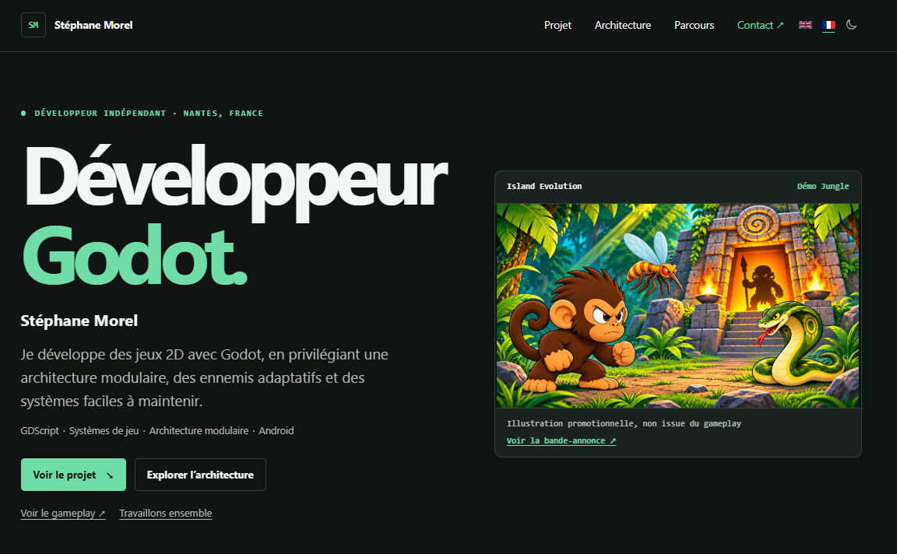

# Présentation technique 

**Stéphane Morel · Gameplay Programmer · Godot 4 / GDScript**

[**Explorer mes réalisations techniques**](https://steph4477.github.io/)

Architecture modulaire, systèmes de gameplay, débogage et développement Android à travers le projet **Island Evolution**.

### Présentation

### Architecture logicielle

### Systèmes de gameplay et débogage

### Développement Android

## Technologies

**Portfolio :** SvelteKit · TypeScript · SCSS · GitHub Pages  
**Jeu présenté :** Godot 4 · GDScript · Android

---

**[Explorer mes réalisations techniques](https://steph4477.github.io/)** · **[Découvrir le site officiel d’Island Evolution](https://steph4477.github.io/IslandEvolution-Website/)**

