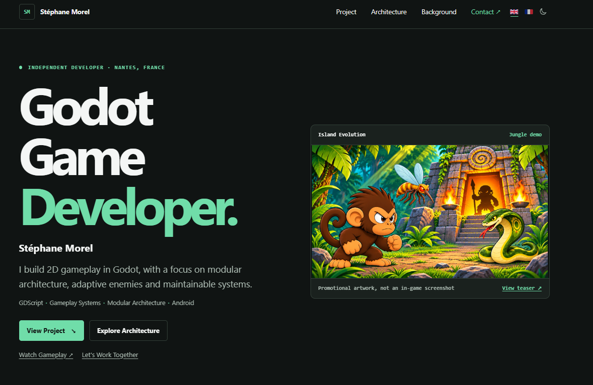
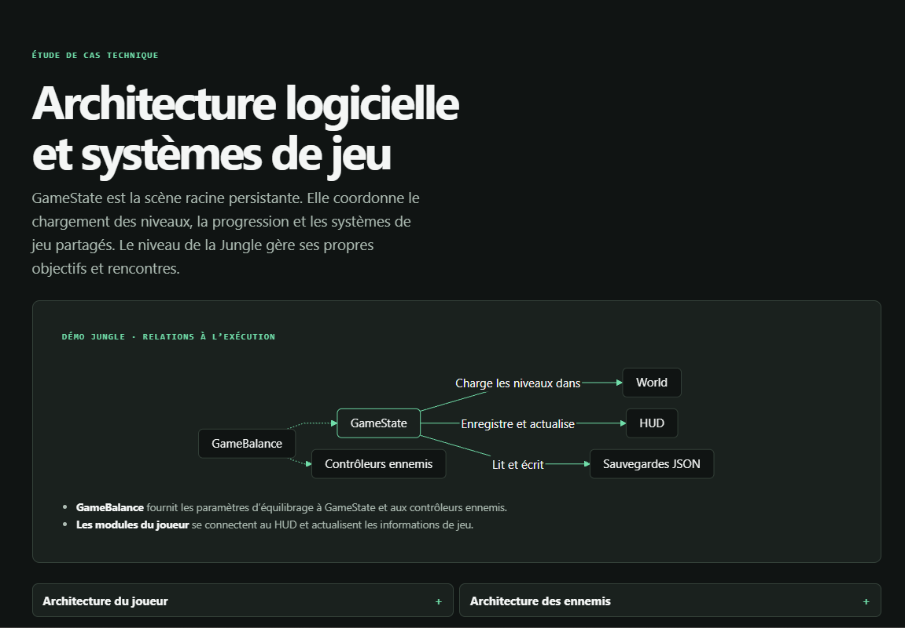
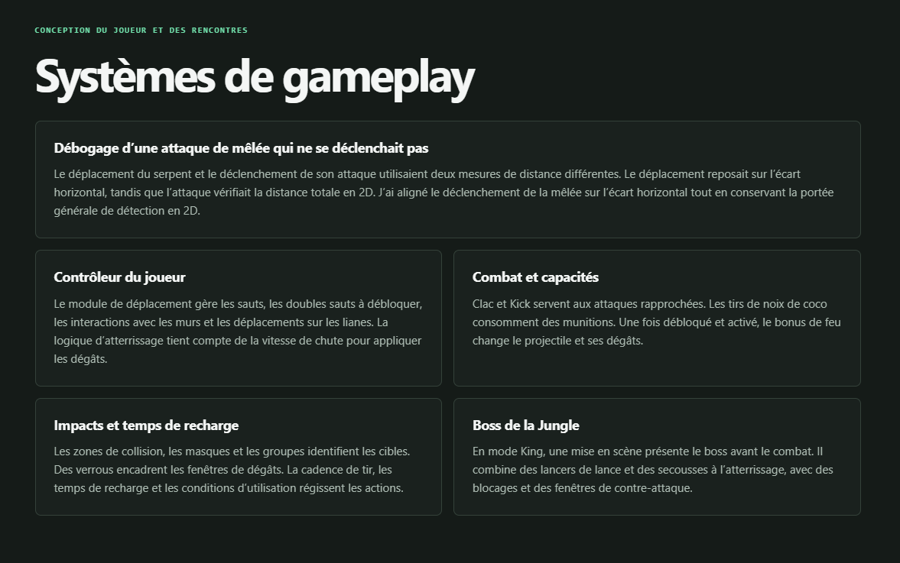
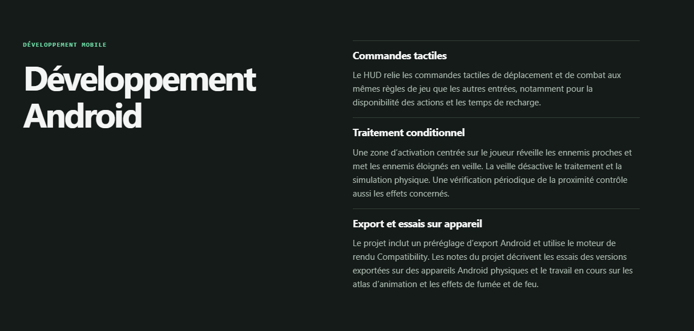

 

# Technical Showcase

**Stéphane Morel · Gameplay Programmer · Godot 4 / GDScript**

**[Explore My Technical Work](https://steph4477.github.io/IslandEvolution-Tech/)**

Modular architecture, gameplay systems, debugging, and Android development through the **Island Evolution** project.

### Overview

### Software Architecture

### Gameplay Systems & Debugging

### Android Development

## Technologies

**Technical Showcase:** SvelteKit · TypeScript · SCSS · GitHub Pages  
**Featured Game:** Godot 4 · GDScript · Android

---

**[Explore My Technical Work](https://steph4477.github.io/IslandEvolution-Tech/)** · **[Discover the Official Island Evolution Website](https://steph4477.github.io/IslandEvolution-Website/)**

